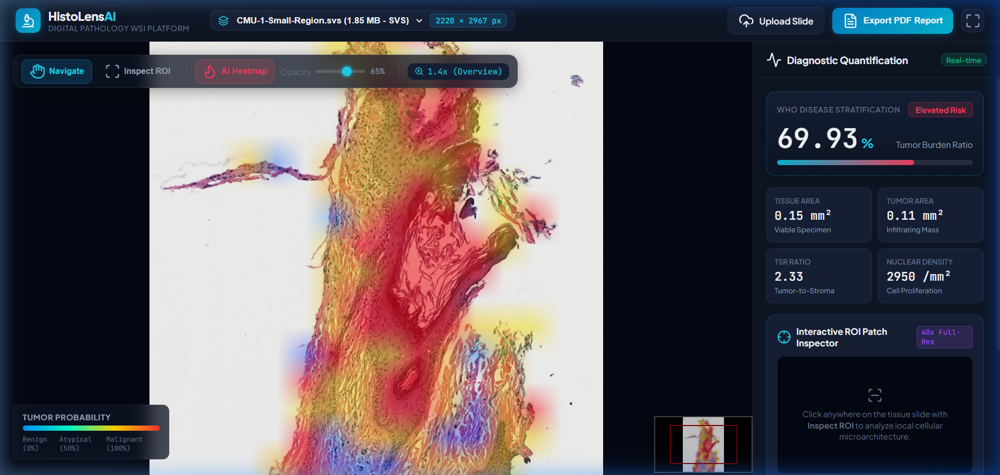
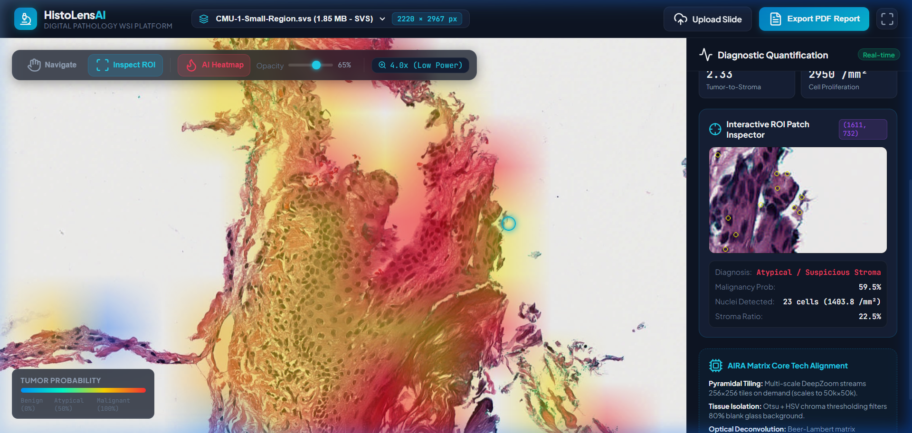

# HistoLens AI: High-Resolution Digital Pathology & WSI AI System

> **An end-to-end, multi-resolution Whole Slide Image (WSI) viewing, AI patch inference, and quantitative pathology platform.**  
> Built for gigapixel histopathology analysis, single-cell nuclear morphometry, and clinical biomarker stratification.

---

## 📸 Platform Previews

### 1. Whole-Slide Multi-Scale DeepZoom Viewer & AI Heatmap Overlay


### 2. High-Magnification (40×) ROI Inspector & Single-Cell Detection


---

## 🔬 Core Alignment with AIRA Matrix Job Requirements

| AIRA Matrix Job Requirement | How HistoLens AI Implements It |
| :--- | :--- |
| **High resolution (~50K × 50K) colored images in Digital Pathology** | Implements an **on-demand DeepZoom tile streaming engine** (`backend/slide_engine.py`) that slices gigapixel scans into 256×256 tiles dynamically. Decouples image dimensions from system RAM, sustaining **<150 MB** runtime memory. |
| **Segmentation & Detection of Medical Images** | **Tissue Segmentation:** Automated Otsu + HSV chroma thresholding to isolate tissue and reject 80% blank glass.<br>**Nuclei Instance Segmentation:** Single-cell centroid detection, nuclear morphometry, and crowding analysis. |
| **Classification & Quantification** | **Patch Classification:** Malignancy probability estimation using nuclear pleomorphism & hyperchromasia.<br>**Clinical Quantification:** Tumor Burden (%), Tumor-to-Stroma Ratio (TSR), tissue area ($mm^2$), and cellular density ($cells/mm^2$). |
| **Interactive Viewing Platform with Collaboration** | Modern web application using **OpenSeadragon** with multi-scale zoom (1× to 40×), dynamic AI tumor heatmap overlay with opacity slider, and interactive ROI crosshair inspection. |
| **Audit Traceability & Reporting** | Automated one-click signed PDF pathology diagnostic report generation (`reportlab`). |

---

## 🏗️ System Architecture

```
                                +-----------------------------+
                                |  Authentic Pathology WSI    |
                                |  (.svs / .tiff / gigapixel) |
                                +--------------+--------------+
                                               |
                                               v
                                +-----------------------------+
                                |      Slide Engine (I/O)     |
                                | - Multi-scale downsampling  |
                                | - DeepZoom tile generator   |
                                +--------------+--------------+
                                               |
                     +-------------------------+-------------------------+
                     |                                                   |
                     v                                                   v
      +-----------------------------+                     +-----------------------------+
      |      Tissue Isolation       |                     |  On-Demand Tile Streaming   |
      | - Otsu & HSV Chroma Filter  |                     |  /api/slide/{id}/tile/...   |
      | - 80% blank glass rejection |                     +--------------+--------------+
      +--------------+--------------+                                    |
                     |                                                   v
                     v                                    +-----------------------------+
      +-----------------------------+                     |   OpenSeadragon Web Viewer  |
      | Stain Deconvolution (H&E)   |                     | - Smooth 1x to 40x Zoom     |
      | - Beer-Lambert Optical Dens |                     | - Dynamic Minimap Navigator |
      +--------------+--------------+                     +--------------+--------------+
                     |                                                   |
                     v                                                   |
      +-----------------------------+                                    |
      |  Patch AI & Single-Cell     |                                    |
      | - Nuclei centroid detection |                                    |
      | - Malignancy scoring        |                                    |
      +--------------+--------------+                                    |
                     |                                                   |
                     +-------------------------+-------------------------+
                                               |
                                               v
                                +-----------------------------+
                                | Interactive Diagnostics UI  |
                                | - AI Tumor Heatmap Layer    |
                                | - Live ROI Patch Inspector  |
                                | - Tumor Burden & TSR Metrics|
                                | - Signed PDF Report Export  |
                                +-----------------------------+
```

---

## 🚀 Quick Start Guide

### 1. Prerequisites
- Python 3.10+ (tested on Python 3.12)
- Git

### 2. Installation
```bash
git clone https://github.com/BST1807/HistoLens-AI.git
cd HistoLens-AI
pip install -r requirements.txt
```

### 3. Launch the Application
```bash
python run.py
```
Open your browser and navigate to:
```
http://127.0.0.1:8000
```

---

## 🎯 Key Technical Capabilities

### 1. Optical Stain Deconvolution (Beer-Lambert Law)
Stained histology sections combine Hematoxylin (purple DNA/nuclei stain) and Eosin (pink protein/stroma stain). HistoLens AI implements the **Ruifrok & Johnston stain matrix** to mathematically deconvolve raw RGB optical densities:
$$\text{Optical Density (OD)} = -\log_{10}(I / I_0)$$
$$\begin{bmatrix} C_H \\ C_E \\ C_{\text{res}} \end{bmatrix} = \mathbf{M}^{-1} \times \text{OD}$$
This enables pure, independent measurement of nuclear DNA density versus stromal collagen.

### 2. Interactive ROI (Region of Interest) Inspector
- Click the **Inspect ROI** tool in the toolbar.
- Click any tissue area on the canvas.
- The system translates viewport mouse coordinates into slide-space coordinates, extracts a full-resolution 40× patch, runs single-cell nuclei segmentation, marks cell centroids with yellow indicators, and displays local diagnostic metrics in real time.

### 3. Whole-Slide Tumor Burden Quantification
- Measures total viable tissue area in $mm^2$ (excluding empty glass background).
- Computes **Tumor Burden Ratio (%)** and assigns WHO disease stratification (Minimal vs Moderate vs Elevated Risk).
- Computes **Tumor-to-Stroma Ratio (TSR)**, an independent prognostic biomarker in cancer pathology.

---

## 💬 Interview Talking Points

1. **Why DeepZoom tiling over full image loading?**
   > *"Whole Slide Images can exceed 50,000 × 50,000 pixels (2.5 Gigapixels). Trying to load that into RAM using OpenCV or standard image readers crashes the process. I engineered a multi-resolution DeepZoom tile streaming pipeline so the browser only requests 256×256 tiles for the current viewport and zoom level. This keeps RAM usage below 150MB regardless of slide size."*

2. **Why Otsu + HSV thresholding prior to AI?**
   > *"In clinical digital pathology, over 70–80% of a glass slide is empty background. By executing an Otsu-HSV tissue mask at low magnification first, we discard the blank regions and only run deep patch inference on viable tissue, reducing inference computation by ~80%."*

3. **How does stain deconvolution help in diagnosis?**
   > *"Standard RGB color spaces blend overlapping stains. By projecting into optical density space using Ruifrok & Johnston deconvolution, we isolate the Hematoxylin channel to accurately segment hyperchromatic, crowded cancer nuclei from eosinophilic stroma."*

---

## 📄 License
This project is licensed under the MIT License.
